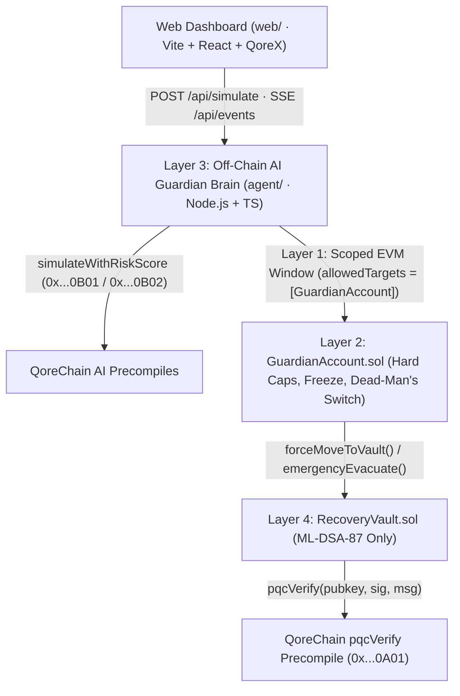

# QoreGuardian

**Autonomous Post-Quantum Treasury Guardian**  
*Built for QoreChain Developer Fest 2026 ("Build Before Q-Day") · Track: Post-Quantum AI Agents*

> **"They leash agents so they can spend. We built a guardian that protects."**

---

## What Is QoreGuardian?

While most AI agents are put on a leash so they can spend safely, **QoreGuardian** is built as an always-on **bodyguard**. It continuously monitors treasury activity for key leaks, prompt-injection attacks, and anomalous spending, and automatically:

1. **Reduces its own spending limits** (`reduceLimits`)
2. **Freezes the smart account** (`freeze`)
3. **Force-moves 100% of remaining funds** (`forceMoveToVault`) into a post-quantum **`RecoveryVault`** that **only the human owner** can unlock using a fresh **`ML-DSA-87`** signature verified on-chain via QoreChain's `pqcVerify` precompile (`0x0000000000000000000000000000000000000A01`).

Even if the AI agent goes offline, the human owner can trigger the **Post-Quantum Dead-Man's Switch** (`emergencyEvacuate`) directly with an `ML-DSA-87` proof.

---

## 4-Layer Defense-in-Depth Architecture



| Layer | Component | Security Guarantee |
| :--- | :--- | :--- |
| **1. Protocol Layer** | QoreChain Scoped EVM Window (`openEvmWindowMsg`) | Locks Guardian Agent EVM calls strictly to `GuardianAccount.sol` with bounded block/tx/value caps. |
| **2. Smart Account** | `contracts/src/GuardianAccount.sol` | Enforces `perTxLimit`, `dailyLimit`, `allowlist`, `isFrozen`, strict privilege separation (`guardianAgent` can never raise limits or unfreeze), and `emergencyEvacuate()`. |
| **3. AI Brain** | `agent/src/riskEngine.ts` + `monitor.ts` + `defender.ts` | Combines QoreChain `simulateWithRiskScore` with deterministic anomaly scoring (0–100), prompt-injection detection, and leaked-key detection, streaming reasoning over SSE. |
| **4. Post-Quantum Vault** | `contracts/src/RecoveryVault.sol` | Zero classical withdrawal paths. Withdrawals require a fresh `ML-DSA-87` signature verified on-chain via `0x...0A01`. |

---

## Live Deployment (`qorechain-diana` · EVM Chain ID `9800`)

- **Live Demo Dashboard:** `<TBD — Add Vercel URL after Phase 18 deploy>` (or `http://localhost:5173` locally)
- **`RecoveryVault.sol`:** [`0xc02bfd69e71054b7aca6a14f9ffb177de4ed1f3e`](https://explore.qore.network/address/0xc02bfd69e71054b7aca6a14f9ffb177de4ed1f3e)
  - Deploy Tx: [`0x780c6b99...5993`](https://explore.qore.network/tx/0x780c6b996f9792d7c6f46ebbb8e28d6ba317969cdfe8fa6231f60c4273645993)
- **`GuardianAccount.sol`:** [`0x30dee7f6fc99d5c0596db47daac68b61e36bd21c`](https://explore.qore.network/address/0x30dee7f6fc99d5c0596db47daac68b61e36bd21c)
  - Deploy Tx: [`0xb70dbd5d...c89a`](https://explore.qore.network/tx/0xb70dbd5d1f4acacfa2283ff60126456ccc9431497bec82131d433bb46a37c89a)
  - Verified Autonomous `forceMoveToVault()` Tx: [`0x783c14e7...2253`](https://explore.qore.network/tx/0x783c14e7707f3bf502960a3d359925d2fb7d1475112eed34abfb1fb3a5582253)
- **`pqcVerify` Precompile:** `0x0000000000000000000000000000000000000A01`

---

## Local Quickstart

### Prerequisites
- Node.js `>= 24.0.0`
- Foundry (`forge`, `cast`) for contract builds/tests

### 1. Smart Contracts (`contracts/`)
```powershell
cd contracts
forge build
forge test -vvv
```

### 2. Off-Chain AI Guardian Agent (`agent/`)
```powershell
cd agent
npm install
cp .env.example .env   # add testnet GUARDIAN_PRIVATE_KEY & GUARDIAN_PQC_RECOVERY_CODE
npm run typecheck
npm test               # deterministic risk engine unit tests
npm start              # starts telemetry + SSE server on http://localhost:8787
```

### 3. Web Dashboard (`web/`)
```powershell
cd web
npm install
npm run build          # tsc --noEmit && vite build
npm run dev            # opens http://localhost:5173
```

---

## Repository Layout

- `contracts/` — `GuardianAccount.sol`, `RecoveryVault.sol`, `IPQCVerify.sol`, Foundry unit/fuzz tests, and `Deploy.s.sol`
- `agent/` — Node.js + TypeScript AI Risk Engine (`riskEngine.ts`), Defender (`defender.ts`), Event Monitor (`monitor.ts`), HTTP/SSE Server (`server.ts`), and `Dockerfile`
- `web/` — Vite + React + TypeScript dashboard (`TreasuryStatusCard`, `QDayAttackerPanel`, `PromptInjectionPanel`, `PqcRecoveryPanel`, `ExplainableAiFeed`) + `vercel.json`
- `scripts/` — Testnet setup, Scoped EVM Window verification, and deployment scripts
- `docs/` — Architecture, PRD, 20-phase playbook, project memory, and demo video script
